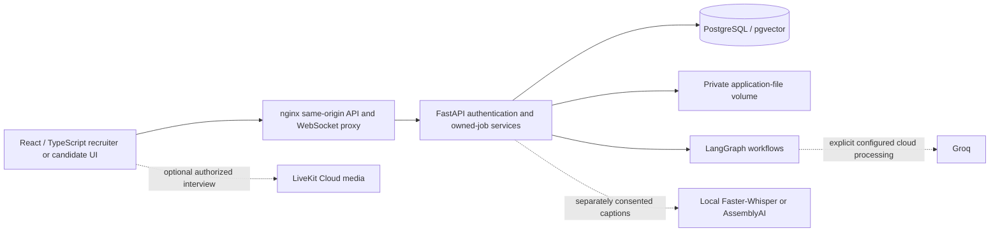

# TalentTrace AI

**BJIT reviewer:** [Final documents and evidence](docs/00_START_HERE.md) · [Current audit](docs/final_submission_audit_20261028.md) · [Deadline closure](docs/deadline_closure_20261028.md)

TalentTrace AI is a recruiter workspace for job-specific CV screening, reviewed interviews and source-linked assessment. It supports human review; it does not make autonomous hiring decisions or certify identity, fairness or candidate competence.

**Acceptance is PARTIAL.** Real Groq, LiveKit and AssemblyAI successes have different scopes. Cloning or starting the default containers does **not** enable a complete real-provider recruitment pipeline. See the evidence table below before demonstrating features.

## What is implemented

| Area | Purpose and current evidence |
| --- | --- |
| F1 — CV screening | Native PDF/DOCX intake, OCR where configured, trusted imports, must-have eligibility and conservative ranking. Real synthetic Groq/OCR samples passed; complete 20-CV performance/ranking remains partial. |
| F2 — scoring | Explicitly reviewed weights, deterministic arithmetic, source evidence, ties and persisted revision-specific scores. Uncertain, excluded and failed applications are not silently assigned zero. |
| F3 — interview media | Recruiter-reviewed booking and private candidate access; real two-party generated LiveKit Cloud media passed. Self-hosted recovery and remote HTTPS deployment remain unverified. |
| F4 — transcription | Role-scoped AudioWorklet PCM, independent caption consent, optional two-party storage consent, finalization, retrieval and withdrawal. Real AssemblyAI API persistence and offline browser 24/24-turn persistence passed separately. Complete real browser recognized/stored speech remains partial. |
| F5 — grounded interview analysis | LangGraph Q&A segmentation, requirement association, curated technical-reference retrieval, grounded evaluation and persistence. Current authenticated browser evidence used a clearly labelled deterministic model double; historical real Groq evidence is separate. |
| F6 — consolidated assessment | Authorized same-application/revision CV and interview evidence, strengths/gaps, comparison and print. Bounded synthetic browser/print evidence passed; no invented combined numeric score. |
| F11 — Dynamic Interviewer Co-Pilot | Model-free LangGraph turns trusted finalized F4 events into provisional recruiter-only follow-ups. Independent consent, dismissal and withdrawal passed with fake STT in the actual application. Real Cloud F4→F11 remains unverified. |

Also implemented: saved Job References and JD refinement, job-isolated received/new/viewed counts, recruiter booking and separate candidate self-scheduling, reviewed appointment email, publishing previews and trusted CV import. One private Discord post and one approved Google Form import passed; these do not establish automatic synchronization or inbox delivery. Telegram is implemented but not live-verified. Face/sharing/integrity limits are in the [audit](docs/final_submission_audit_20261028.md).

## Architecture and technology choices



- **React/Vite/TypeScript:** one shared recruiter workspace, separate candidate invitation routes, browser media and accessible native controls.
- **FastAPI/Pydantic:** typed request/response validation, session authentication, origin/CSRF checks and recruiter/job/revision isolation.
- **PostgreSQL/SQLAlchemy/Alembic:** saved jobs, scores, booking, delivery reservations, transcript privacy and evaluations. pgvector supports locally embedded policy/reference retrieval.
- **LangGraph:** explicit state transitions rather than a new general-purpose agent. JD generation grounds requirements in a selected company policy; screening validates extraction and matching before eligibility/scoring; F5 pairs, maps, retrieves, assesses and validates; F11 conservatively follows trusted caption context without an LLM.
- **Groq:** optional configured JD/CV and evaluation inference. Provider selection is explicit and pinned to an existing conversation; unavailable providers do not silently fall back.
- **LiveKit / AudioWorklet / STT:** media, role-scoped audio capture and consented recognition remain separate responsibilities. Captions do not require durable transcript storage.

See [implemented architecture](docs/architecture/application_overview.md), [F2](docs/f2_scoring.md), [F5 references](docs/technical_reference_grounding.md) and [F11 rationale](docs/f11_final_acceptance_20261027.md).

## Reviewer quick start — fresh provider-disabled Docker deployment

Prerequisites: Git/private repository access, Docker Engine with Compose v2 (Linux containers), Python 3.12+, an unused loopback port and sufficient RAM/disk. First builds need public dependency/base-image downloads and several GB; they do not download model weights. Host Node/pnpm/backend virtual environments are unnecessary for container startup.

Clone into a **new** directory; never overwrite an existing checkout:

```powershell
git clone --branch develop --single-branch https://github.com/shafi-mahmud/TalentTrace-AI.git TalentTrace-AI-reviewer
cd TalentTrace-AI-reviewer
git status --short
git rev-parse HEAD
```

Record the actual commit. The published baseline before this closure was `30468aca4a0ee43d8a315dd5bdd43269711507b9`; later local closure changes require separately approved publication. A clean checkout and expected reviewed revision are prerequisites.

The following PowerShell commands create a new project/configuration. Choose another port if 5188 is occupied. On Linux Mint, use the equivalent shell variables (`Project=tt-reviewer-$(date +%s); EnvFile=data/docker-demo.env`) and the same Docker arguments.

```powershell
$Project = 'tt-reviewer-' + ([guid]::NewGuid().ToString('N').Substring(0,10))
$EnvFile = 'data/docker-demo.env'
docker ps -a --filter "label=com.docker.compose.project=$Project"
docker volume ls --filter "label=com.docker.compose.project=$Project"
# Both must be empty before creating this project. Check the chosen port is free.
python docker/configure.py --port 5188
docker compose -p $Project --env-file $EnvFile config --quiet
docker compose -p $Project --env-file $EnvFile build
docker compose -p $Project --env-file $EnvFile up -d --wait db
```

This fresh-clone command also works on the published baseline. The closure adds `--output data/<new-profile>.env` for another independently owned profile in an existing checkout; it still refuses overwrites.

Keep the ignored env file private. Do not print resolved Compose configuration or container environments. The helper generates a random password, copies no old settings and refuses an existing output file; Windows file privacy also depends on NTFS permissions.

**Before migration:** verify the new project's volume labels and database identity. Never apply these steps to an office, Groq or preserved database.

```powershell
docker compose -p $Project --env-file $EnvFile exec -T db psql -U talenttrace_demo -d talenttrace_docker_demo -c "SELECT current_database(),current_user; SELECT count(*) FROM pg_tables WHERE schemaname='public';"
# Expected: talenttrace_docker_demo / talenttrace_demo and 0 public tables.
docker compose -p $Project --env-file $EnvFile run --rm --no-deps backend python -m alembic upgrade head
docker compose -p $Project --env-file $EnvFile run --rm --no-deps backend python -m alembic current
# Expected single head: 0017_booked_interview_email.
docker compose -p $Project --env-file $EnvFile up -d --wait --wait-timeout 180
docker compose -p $Project --env-file $EnvFile exec backend python -m app.db.provision_recruiter
```

Provision a fictional `@example.test` recruiter and a unique 15–128-character password when prompted; never put passwords on a command line. Open **http://127.0.0.1:5188/**, sign in and expect an empty owned workspace. Stay on that origin; changing to `localhost` changes the cookie/origin contract.

```powershell
python docker/verify.py --project $Project --env-file $EnvFile
docker compose -p $Project --env-file $EnvFile ps
# Later starts preserve the same env file, project and volumes:
docker compose -p $Project --env-file $EnvFile up -d --wait --wait-timeout 180
# Stop only this project, preserving its data:
docker compose -p $Project --env-file $EnvFile stop
```

Normal startup does not migrate, seed policy or create accounts. The optional verifier flag `--allow-synthetic-records` creates two fictional recruiters/one job and recreates **that disposable project's** containers to test persistence; do not use it on a preserved deployment. Never use global prune, `down --volumes`, or copy an old database URL into reviewer configuration.

### What works without provider credentials?

Baseline: health, authentication, empty Home, owned workspace APIs, private file storage and safe unavailable states. Existing saved data can be read after restart. **AI-generated JD/scores, Cloud media and speech recognition do not become available automatically**; this baseline does not seed a complete demo. Fresh current-host startup is different from a second clean-machine/full-feature N21 PASS.

### Optional real Groq setup

Use a **separate fresh project**, a private Groq key with owner-verified free allowance and a complete pre-existing `BAAI/bge-small-en-v1.5` cache. `docker/configure_groq.py` additionally needs `python-dotenv` in the host Python environment (provided by the backend dependency environment). Validate it with `python -c "import dotenv"` before running the helper. Do not copy Windows virtual environments or download models automatically.

```powershell
python docker/configure_groq.py --source-env '<private-local-env-file>' --bge-cache '<existing-model-cache>' --output data/reviewer-groq --port 5190
$G = @('compose','--env-file','data/reviewer-groq/compose.env','-f','compose.yaml','-f','compose.groq.yaml')
docker @G config --quiet
docker @G build
docker @G up -d --wait db
docker @G exec -T db psql -U talenttrace_demo -d talenttrace_docker_demo -c "SELECT current_database(),current_user; SELECT count(*) FROM pg_tables WHERE schemaname='public';"
# Only after confirming this new project, expected identity and 0 public tables:
docker @G run --rm --no-deps backend python -m alembic upgrade head
docker @G run --rm --no-deps backend python -m app.rag.seed_demo_policy
```

Save the returned fictional policy document UUID as `COMPANY_POLICY_DOCUMENT_ID` in the new private `data/reviewer-groq/groq.env`; it is database-specific. Then:

```powershell
docker @G up -d --wait --wait-timeout 180
docker @G exec backend python -m app.db.provision_recruiter
```

Use **http://groq-20261026.localhost:5190/** (the helper's configured origin), not 127.0.0.1. Groq is preferred only when available; approve the JD cloud-processing acknowledgement yourself. CV transfer consent remains separate and unchecked. Models/key/quota and local policy embeddings must all be valid. Failed or uncertain operations are not permission to retry indefinitely. [Groq guide](docs/groq_runtime.md).

### Other optional services

| Feature | Additional prerequisites; never enabled merely by cloning |
| --- | --- |
| F3 | Private LiveKit Cloud credentials, development synthetic opt-in, valid owned booking/invitation, supported browser and approved free quota. Current local URLs do not serve a remote phone/laptop. |
| F4 | Existing local Faster-Whisper/CPU dependencies and approved model assets **or** explicitly scoped AssemblyAI live settings/key/free quota; per-role caption consent. Both storage consents are needed before durable capture. Generated speech controls are development-only. |
| F5/F6 interview evidence | Authorized finalized, consented, retained, non-withdrawn transcript; exact job/revision allowlist, technical references and configured evaluation provider. CV-only F6 does not require fabricated interview evidence. |
| F11 | Separate feature flags and both assistant consents; trusted finalized F4 events. No own transcript/suggestion persistence or mandatory storage consent. |
| Email / publishing / Google | Separate reviewed private transport credentials, recipient/destination restrictions and explicit owner action. No real delivery, posting or synchronization runs at startup. |
| Face workflow | Experimental synthetic-only assets and Linux vault support; disabled on Windows. No real biometric verification or identity certification. |

Do not enable a provider simply to hide an unavailable status. See [.env.example](.env.example) and the scoped guides, never share a real `.env`, invitation bearer, OAuth token or resolved Compose output.

## Privacy, fairness and known mandatory gaps

- Keep CVs, contact information, recordings, transcripts, model assets and runtime databases outside Git. Session/ownership/revision checks and independent caption/storage/assistant consents remain required. No physical-device or private data processing is authorized by these setup instructions.
- Groq receives explicitly approved JD/policy or CV content; LiveKit transports approved media; AssemblyAI receives consented audio. Provider processing/training policies and quota must be reviewed before use. Local inference is not an automatic cloud fallback.
- Missing/ambiguous evidence means review/abstention, not lack of skill. ASR and LLM outputs can be wrong. No automated hiring decision, bias-free claim or face/attention-based adverse judgment is justified.
- **N19 remains incomplete:** guarded deletion handles one exact imported submission in an isolated maintenance lab. Transcript withdrawal is not candidate-wide erasure. Linked interviews, delivery state, shared JSON, transient work, backups and external copies need a coordinated deletion design.
- **N1 remains partial:** the measured 20-CV run did not score/rank every application; offline arithmetic fixtures are not a provider performance benchmark.
- **N21 remains partial:** same-host disposable Docker evidence does not prove clean second-machine/full-feature operation. Complete live F4→F5/F11 acceptance and remote HTTPS deployment remain unverified.

**Owner-reported trainer clarification, 28 October 2026:** the project owner reports that the trainer subsequently permitted AI assistance. No independent approval document was supplied or verified; this statement does not invent one or certify originality/compliance.

## Development checks and submission material

Use Node 24 / pnpm 11.25.0 and the pinned frontend lockfile. Backend uses Python 3.12 and `backend/requirements.txt`; keep secrets absent and external providers mocked in tests.

```text
pnpm --dir frontend install --frozen-lockfile
pnpm --dir frontend test
pnpm --dir frontend exec tsc -b
pnpm --dir frontend exec vite build
```

Focused acceptance results, remaining blockers and new commits are recorded in [deadline closure](docs/deadline_closure_20261028.md). The [four final uploads](docs/00_START_HERE.md#final-submission-documents) are WBS, SRS, HLD and System Design. Uploaded requirements/designs express intent, not proof that every requirement passed. Presentation approval remains separate.

<details>
<summary>Historical milestones and earlier recorded implementation notes</summary>

The following records retain their original dates and scope. The current evidence index and deadline closure above supersede them only for explicitly verified boundaries.

## Current office submission checkpoint — 26 October 2026

Latest review: [final consolidated submission audit](docs/final_submission_audit_20261028.md), with [Docker/BID proof](docs/task8_release_audit_20261028.md) kept separately.
It separates current source, recorded acceptance and remaining mandatory gaps;
older checkpoint statements below retain their original scope.

The accepted office history through `7924c76` is integrated into `develop`; `main` remains separate. Later local audit/presentation commits require separate integration review.
See the [current acceptance matrix and recruiter walkthrough](docs/submission_walkthrough_20261026.md)
and [trainer feature status](docs/trainer_feature_status_20261026.md).
Real synthetic browser scheduling/reload passed. Complete current-source
F3 → local F4 → F11 media/privacy acceptance remains pending; historical Cloud
media success and mocked integration tests are labelled separately. Optional
providers, publishing, email and Windows-incompatible biometric storage must not
be enabled merely to demonstrate an unavailable capability.

The older release records below remain historical; newer scoped evidence
supersedes them only for the explicitly tested boundary.

### Submission-day application and setup

Latest 27 October [manual F4 acceptance](docs/task4d_live_acceptance_20261027.md)
is **PARTIAL**: two participants joined and captions became active according to
the owner; storage consent was incomplete and AssemblyAI termination acknowledgement
is unconfirmed. LiveKit is owner-confirmed closed. No full live transcript-storage
acceptance is claimed. The [submission artifact inventory](docs/submission_package_20261026.md#required-submission-artifacts)
distinguishes tracked source/docs from local SRS draft, WBS and presentation files
that require separate owner review/attachment.

- [Final demo results, tests, limitations and submission instructions](docs/submission_package_20261026.md)
- [Implemented architecture and security boundaries](docs/architecture/application_overview.md)
- [Step-by-step recruiter walkthrough and fourteen-area trainer matrix](docs/submission_walkthrough_20261026.md)

The earlier provider-disabled office demo was `http://submission-20261026.localhost:5276/`,
scheduled to stop **26 October 2026 at 16:14:34 Asia/Dhaka**. Its synthetic account
details and disposable data are local, ignored artifacts, not transferable Git assets.
It uses real authenticated APIs and PostgreSQL schema 0017. AI generation/screening,
Cloud, STT, email, publishing and biometric integrations remain disabled. The sample
JD and saved scores are seeded fixtures; they do not establish inference quality.

The separate [opt-in Groq Docker runtime](docs/groq_runtime.md) now serves
`http://groq-20261026.localhost:5280/`. One real synthetic Groq JD request, local
policy retrieval, saved Job Reference/revision and fresh-session/browser retrieval
passed. [Task 2 acceptance](docs/task2_acceptance_20261026.md) additionally records
real refinement/OCR screening and locally ready, mocked-only Discord MCP delivery.
Later scoped evidence records [one real private Discord MCP post](docs/jd_chat_publishing_20261028.md) and [one approved Google application import](docs/google_single_import_20261028.md). Telegram and automatic Google synchronization are not live-verified. Its documented single
Compose startup command reuses explicitly prepared private configuration, images
and a fresh schema-0017 database; first-time setup remains separate.

For a new machine, follow [Docker setup](docs/docker_startup.md) using a verified
unused Compose project and a fresh database. `python docker/configure.py` creates
private configuration without printing its password. Build, explicitly migrate only
the new database to the single current head `0017_booked_interview_email`, start the
baseline and provision a synthetic recruiter using that guide. Existing databases
must not be upgraded automatically. The baseline does not bundle working Cloud/STT
models or complete F5 inference; do not promise those integrations from startup alone.

For local frontend checks, use Node 24, the pinned pnpm version and existing lockfile:

```text
pnpm --dir frontend install --frozen-lockfile
pnpm --dir frontend test
pnpm --dir frontend exec tsc -b
pnpm --dir frontend exec vite build
```

Backend tests run from `backend/` with a compatible Python environment containing
the pinned requirements. Keep real credentials out of tests. When configuring a
provider-disabled native environment, leave provider secrets empty rather than
using the example placeholder keys; optional features must remain false.

## Pre-viva release-candidate checkpoint — 19 October 2026

Published private release branch: `feature/pre-viva-release-docs` at `5b6f172`.
[October 20–21 Linux home handover](docs/office_home_handover.md).
Later handover documentation may remain local pending push approval.

**PARTIAL BID acceptance.** Proposed code base: `176ba82` on
`feature/f11-copilot-live-integration`. This documentation checkpoint does not
activate features, migrate data or publish a release.

- [Release inventory and validation gates](docs/release_candidate_checkpoint.md)
- [BID requirement-to-evidence matrix](docs/release_traceability.md)
- [Innovation Feature: Dynamic Interviewer Co-Pilot — rationale](docs/f11_innovation_rationale_draft.md)

F11 is implemented through the trusted live adapter and automated integration;
physical speech-to-suggestion acceptance remains pending. The rationale documents
AI assistance and does not establish originality or independent-design compliance. N19 remains
PARTIAL. This N19 integration-preparation branch includes guarded administrative
deletion for one imported submission in a closed disposable maintenance lab only;
it does not enable candidate-wide erasure or deletion in ordinary deployments.
See [N19 integration scope and validation](docs/n19_integration_preparation.md).
N1 now has a measured 20-input attempt below, with PARTIAL completion; it is not
a successful 20-CV scoring/ranking acceptance result.
N21 has office baseline startup evidence, not full clean-machine acceptance.

## Documentation directory

- [F11 current integration and historical test evidence](docs/f11_copilot_live.md)
- [F11 delivery and independent consent](docs/f11_copilot_delivery.md)
- [F11 model-free contextual logic](docs/f11_copilot_logic.md)
- [Docker setup and its full-application acceptance gap](docs/docker_startup.md)
- [F6 consolidated assessment and reviewer confirmation](docs/f6_consolidated_assessment.md)
- [Controlled Milestone 3 closure](docs/milestone3_closure.md)
- [Product identity](docs/project_naming.md)
- [Architecture diagrams and ADRs](docs/architecture/)
- [Risk register](docs/risk_register.md)
- [Interview access and self-hosted token limitation](docs/interview_invitations.md)

The previously linked `docs/clarifications.md`, `docs/wbs.md` and
`docs/architecture.md` are absent. Their links have been removed rather than
creating invented trainer clarifications or a substitute official WBS. Architecture
PDFs are design records; implemented behavior must be checked against code.

## N1 benchmark — 20 synthetic CVs, PARTIAL (19 October 2026)

[Current offline F1/F2 acceptance review](docs/f1_f2_deadline_acceptance.md)
recomputes the retained scoring outcomes; it is not a new provider benchmark.

Tested source: `b3c00db89aec0f891b039e32a065ec36c2e44ec6`. One actual authenticated
FastAPI batch used local PDF extraction, real free-tier Groq
`openai/gpt-oss-120b` profile/semantic inference, LangGraph screening, unchanged
50/30/20 weighted scoring, ranking and PostgreSQL persistence. No mocks or fixed
scores. Hardware: Intel Core i5-10210U, 4 cores/8 logical processors, approximately
15.84 GiB visible RAM; Windows/Python 3.12, disposable Docker PostgreSQL17/pgvector.

| Measurement | Actual result |
| --- | --- |
| Input / parsed profiles | 20 / 20 synthetic digital PDFs |
| Screening decisions / operational failures | 19 / 1 terminal HTTP429 |
| Eligible / excluded | 15 / 4; failed candidate has no decision |
| Numeric scores / score ranking | 4 / 4 |
| Other score states | 11 uncertain evidence, 4 ineligible, 1 incomplete |
| Eligible requirement-coverage ranking | 15; distinct from numeric-score ranking |
| Total wall time | **449.09 seconds (7m29.09s)** |
| Upload / screen-through-persistence | 0.18 / 448.91 seconds |
| Logged profile stage / screening stage | 273.33 / 174.80 seconds |
| Submitted-input throughput | 2.67 CVs/minute; not successful-score throughput |
| Rate-limit recovery | 36 bounded backoffs; 328 seconds waiting included |

Timing starts before the multipart upload and ends after the single screening
response, including score persistence and ranking. It excludes environment setup,
fixture generation, login/job approval and retrieval verification. API requests
used the real FastAPI ASGI transport rather than a network server/browser, so
network/proxy overhead is excluded. No model prompts used expected fixture answers.

All 20 revisioned score-state records were retrieved from PostgreSQL and matched
the response. Numeric ranking is reconstructed from persisted scores, not stored
as an independent ranking snapshot. All 19 completed mandatory-Python decisions
matched the original synthetic facts. Conservative uncertainty was preserved;
no screening failure was converted into rejection or a fabricated score.

Reproduce with a fresh disposable database/storage, explicit migrations and
administrative fictional recruiter provisioning; authenticate; create a manual
job and confirm criteria; upload 20 PDFs; call the owned batch `/screen` endpoint
once; retrieve `/jobs/{job_id}/batches/{batch_id}/scores`. The fictional job used
mandatory Python, optional SQL, minimum 2 years relevant experience and BSc Computer
Science. Inputs vary skill presence, 1–6 years experience and degree presence.
Reproduction requires separately approved free provider access and sufficient
quota. Exact synthetic PDFs, hashes, fixture-generation/API scripts, sanitized
timings and resource samples are retained locally under ignored `data/n1-20-cv/`;
they are not shipped in Git, so this README is not a self-contained benchmark kit.

This is **PARTIAL N1 evidence**, not full 20-CV completion: only 4 numeric scores
were produced, 11 eligible applications remained uncertain and one screening
failed after existing retry limits. Ineligible candidates remain excluded from
displayed rankings. Small digital synthetic PDFs do not establish scanned-CV,
long-document, semantic accuracy, repeated-run stability or all-candidate ranking
acceptance. No automatic second attempt was made.

## Isolated Docker startup — synthetic development

Requires Docker with Linux containers, Compose v2+, and Python 3.10+ on the host
only for the private-configuration helper. Run from the repository root:

```text
python docker/configure.py
docker compose -p talenttrace-docker-demo --env-file data/docker-demo.env build
docker compose -p talenttrace-docker-demo --env-file data/docker-demo.env up -d --wait db
docker compose -p talenttrace-docker-demo --env-file data/docker-demo.env run --rm --no-deps backend python -m alembic upgrade head
docker compose -p talenttrace-docker-demo --env-file data/docker-demo.env up -d --wait --wait-timeout 180
```

Open **http://127.0.0.1:5188/**. First setup starts with an empty, separate
database. No accounts, jobs or candidate records are seeded. Provision a synthetic
recruiter explicitly when ready:

```text
docker compose -p talenttrace-docker-demo --env-file data/docker-demo.env exec backend python -m app.db.provision_recruiter
```

Subsequent startup is one command, preserving named volumes:

```text
docker compose -p talenttrace-docker-demo --env-file data/docker-demo.env up -d --build --wait --wait-timeout 180
```

This is a local synthetic baseline, not production or a full clean-machine BID
acceptance claim. It keeps SMTP, LiveKit, captions/storage, F5 inference and reviewer
confirmation disabled. No private office environment, model or data is copied.
The internal network prevents backend/database Internet access. See the setup guide for
readiness, stop/reset boundaries, tests and limitations before using other features.

</details>
