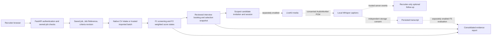

# Implemented application architecture

Submission review: 26 October 2026. This describes inspected code, not proof that
every optional integration is active. The office demo uses real API/database
execution with providers disabled and synthetic fixtures; live F4/F11 acceptance
remains unobserved. No Cloud retry is part of the submission demonstration.

## Entry points and relationships

- `frontend/src/main.tsx` captures an invitation fragment before rendering
  `App.tsx`; candidate invitation, self-scheduling and transcript-privacy routes
  are separate from the authenticated recruiter workspace.
- Recruiter Home, JD Assistant, Candidate Screening and Interview Scheduling
  share the active saved job through `recruiterWorkspace.ts`. Job Reference is
  server-issued; conversation refinement preserves job identity while criteria
  approval is revision-scoped. Internal UUIDs are not the recruiter-facing reference.
- `backend/app/main.py` mounts the authenticated and role-specific routers.
  Session cookies, mutation protection and owned-job checks precede sensitive work.
  Jobs and conversations are scoped to their recruiter, not a browser-supplied owner.
- Application identity is `(job_id, batch_id, upload_id)`. Native files and
  `ExternalCvSubmissionRecord`/trusted import provenance are distinct intake paths.
  Notifications reconcile applications and explicit viewed acknowledgements; they
  do not infer universal person identity or automatically acknowledge on refresh.
- `CandidateScoreRecord` stores validated F2 results and criteria revision.
  Uncertain/excluded/failed applications are not assigned fabricated numeric scores.
  `InterviewSchedule` retains the exact selected application and screening snapshot.
- `InterviewInvitation` supports one-use candidate exchange and scoped hashed
  sessions. Joining-window/current-revision checks are separate from recruiter login.
  Invitation possession is not biometric identity verification.
- `booked_interview_email.py` has an interview-scoped durable attempt model distinct
  from self-scheduling email. Preview and explicit send are separate; SMTP acceptance
  is not mailbox delivery, and appointment confirmation contains no joining access.
- `consolidated_assessment.py` validates the application, selected CV evidence and
  authorized F5 source. Missing interview evidence is labelled, not treated as poor
  performance. No automatic combined suitability score/hiring decision is invented.

## Optional integration and privacy boundaries

JD/CV processing has explicit local/API selection. Fixed allowlisted Ollama choices
do not silently fall back to Groq. Local text extraction does not establish LLM
matching quality. New cloud-selection controls retain their disclosure/confirmation.
Publishing preview is separate from Discord/Telegram sends; LinkedIn/other posting
is manual. Production duplicate-send limitations remain documented.

LiveKit grants are role/interview scoped. Caption consent, optional durable storage
consent and F11 assistant consent are independent. The trusted F4 bridge is the live
assistant input; arbitrary frontend transcript injection is not a proof path.
F4 is bounded to short capture sessions; multi-epoch proof is not 30-minute live
acceptance, and one caption room per backend process remains a limit.

Screen sharing and coarse tab/fullscreen reporting are optional, explicit actions;
they are not recording, surveillance or proof of cheating. The synthetic face-viva
prototype does not establish human identity/liveness accuracy. Its persistent vault
is Windows-incompatible and stays disabled in this office demo.

PostgreSQL's single source head is `0017_booked_interview_email`. Docker readiness
compares the database to the code head; `/api/v1/health` alone is liveness, not schema
or provider readiness. Migrations are explicit and never applied automatically to
preserved deployments. N19 deletion remains a guarded maintenance capability, not
an unrestricted recruiter endpoint or candidate-wide erasure guarantee.
