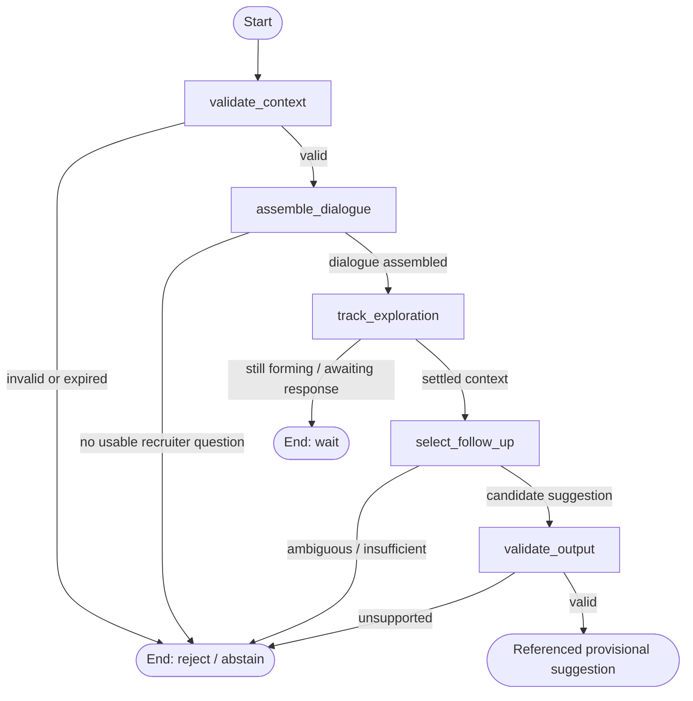

# F11 Increment 5A — offline contextual question assistance

## Implemented, and deliberately not live

Baseline: Docker commit `e33d26b`, branch `feature/f11-copilot-logic`.
This increment implements a model-free bounded LangGraph workflow over supplied
**synthetic** caption events. It can invite a concrete example or move to an unobserved confirmed requirement.
Unfinished exchanges wait; ambiguous or explicitly uncertain exchanges abstain.
It can also wait or abstain. It does not evaluate competence or create scores,
decisions, hiring advice or personality/communication diagnoses.

There are no new endpoints, UI controls, SQL models, migrations, provider calls,
models/downloads or F4/F5 runtime hooks. Existing Docker services are unchanged.
F11 as a whole is **not complete or browser/live verified**. The synthetic marker
is a caller assertion for these offline tests, not production authorization or
proof that arbitrary supplied text is synthetic.

## Files and responsibilities

| File | Purpose |
| --- | --- |
| `backend/app/schemas/interview_copilot.py` | Strict, frozen Pydantic input/output and source contracts; instance revalidation, bounded text, hidden text in repr/errors. |
| `backend/app/agents/copilot/workflow.py` | Internal Limits, five graph nodes, dialogue grouping, conservative lexical association, templates and output validation. |
| `backend/app/services/interview_copilot.py` | Serial in-memory owner of one run: replaceable pending snapshot, generation/source fences, cooldown and bounded fingerprint history. |
| `backend/tests/test_interview_copilot.py` | Synthetic graph, identity, lifecycle, output-safety and no-network/no-persistence tests. |

No additional dependency was introduced. LangGraph is already a project dependency.
The existing LangSmith tracing context is explicitly disabled around invocation,
and custom callbacks/checkpointers are not accepted. Conversation input must not
be exported because a host happens to enable tracing through environment variables.

## Input and output

`Binding` pins interview UUID, co-pilot run UUID, caption-run UUID, confirmed
criteria revision and 1–50 unique requirement IDs/descriptions. Descriptions are
bounded single-line job criteria, not inferred candidate facts. A change to this
binding is refused and pending context cleared; a newly reviewed binding needs
a new logic instance, never a silent rebind.

`Update` contains `synthetic=True`, that binding, a strictly increasing generation
and up to 15 `Event` objects. Each event carries interview/run/revision, snapshot
generation, `Source(caption_run_id, sequence)`, recruiter/candidate role,
run-relative millisecond timestamp and at most 1,000 recognized characters.
Total event text is bounded at 12,000 characters. Unknown fields, control/format
characters, invalid roles/IDs and inconsistent identities are not accepted.

Generation identifies the **snapshot envelope**. A later snapshot can include
unchanged earlier events with its newer generation, while their source identities,
text, timestamps and roles remain immutable. Event digests exclude envelope
generation but include all source content/identity. No transcript database UUID
is fabricated. Future F4 adapters must preserve these semantics explicitly.

`Result` contains a fixed status/reason, generation, conservative exploration
records and zero or one suggestion. Suggestions contain only a known criterion
ID, template kind/question, original caption-source references and
`provisional=True`. There are no score, competence, eligibility or hire/reject
fields. Source references identify the context behind selecting a question; they
are **not evidence that an unobserved requirement was discussed or satisfied**.

## Graph



The service then applies deduplication/dismissal and cooldown before releasing a
suggestion. There is no retry loop or external model node. LangGraph state carries
the pinned binding, current update, clock/limits, normalized recent events,
assembled dialogue, exploration, candidate choice and result. No graph checkpoint
is retained.

1. **validate_context:** enforce binding/event identities, bounds, no future
   timestamps and the context lifetime. Identical duplicated events collapse;
   conflicting source reuse is rejected. Initial snapshot order is normalized by
   timestamp/sequence.
2. **assemble_dialogue:** recognize a small set of recruiter question forms;
   group consecutive fragments and associated candidate responses. Candidate-first
   speech is never relabelled as an interviewer question. Candidate questions and
   intervening interviewer comments mark the association uncertain. Noise is not
   a technical failure by the candidate.
3. **track_exploration:** expose only `not_observed`, `question_observed`,
   `response_observed` and `uncertain_association`. These describe literal topic
   association within this bounded context, not full-interview understanding.
4. **select_follow_up:** invite an example for a settled uniquely associated
   response; abstain on uncertain association and wait for unfinished exchanges. An explicit
   example marker suppresses that example prompt and permits exploration of a
   currently unobserved requirement. It does not validate example quality.
5. **validate_output:** independently resolve original events, current question,
   speaker roles, binding/revision, full source references and usable response
   evidence. Check the fixed template and permitted kind; do not invoke the
   selector or trust its coverage record. Invalid outputs abstain without returning
   the proposed text. Shared lexical safety predicates are not semantic proof.

## State lifecycle and bounds

`submit(update)` replaces the one pending snapshot only when its generation is
newer than both processed and pending generations. `process(now_ms=...)` consumes
it synchronously. No asynchronous scheduler, background thread or live service is
introduced. Callers must serialize access; this is not a cross-process runtime.

| Bound | Implemented policy |
| --- | --- |
| Events / text | At most 15 events / 12,000 characters per snapshot. Smaller internal limits can be injected for tests; input cannot set them. |
| Age | Oldest supplied event must be at most 120 seconds old. An expired window is refused, not silently truncated into a misleading partial dialogue. |
| Fragment settling | Wait at least 3 seconds after the newest event; an unfinished phrase continues waiting until a later linked completion or expiry. A pause does not prove a complete answer. |
| Suggestions | At most **one** new suggestion per processed update (a stricter subset of the reviewed maximum three). |
| Cooldown | At least 15 seconds between emissions; default cannot be overridden by input. |
| Dedup/dismissal | Up to 64 fingerprints, bounded by the 120-second lifetime. This is not a permanent lifetime ban on repeating a question. |
| Source history | Up to 64 content fingerprints plus a sequence watermark. Unknown earlier/evicted source identities fail closed rather than being replayed. |
| Pending work | One replaceable snapshot; processing consumes it. No retained text queue. |

`clear()` releases pending text and fingerprint histories while retaining numeric
generation/sequence fences. Rejected source conflicts or expired processing also
clear state. No full text is retained by the service after processing. The caller
still owns any input/result objects it kept.

**Important privacy boundary:** this pure synchronous increment checks TTL when
processing; it does not run a wall-clock timer to erase an abandoned pending
object. 5B must schedule expiry and call clear on disconnect/withdrawal/end, and
release its own objects. Python reference release is not guaranteed memory
zeroization. Do not claim durable authorization/revocation for this offline class.

## Example synthetic execution

Supplied revision-2 requirements: `python: Python`, `sql: SQL`.
Event 1 (recruiter, 0 ms): “Explain Python.”
Event 2 (candidate, 1,000 ms): “Python lists are mutable ordered sequences.”
Process at 6,000 ms after submitting generation 1.

```json
{
  "status": "suggested",
  "reason": "valid_suggestion",
  "exploration": {"python": "response_observed", "sql": "not_observed"},
  "suggestion": {
    "criterion_id": "python",
    "kind": "example",
    "question": "Could you walk through a concrete example related to this requirement: Python?",
    "source_sequences": [1, 2],
    "provisional": true
  }
}
```

This is an abbreviated presentation of the actual schema, not an API payload.
It invites an example; it does **not** assert that the candidate failed to provide
one. If a later event says “For example, append adds an item,” a newer snapshot
suppresses the Python example prompt and can offer SQL exploration after cooldown.
Ambiguous Python-and-SQL association and candidate clarification questions abstain. These changes make the logic contextual rather than a
fixed checklist, while retaining its lexical limitations.

## Why LangGraph, and how this differs from F5

Each stage owns a small explicit responsibility with inspectable state. Conditional
edges represent real waiting, rejection and abstention. This is a reactive
deterministic workflow, not an autonomous reasoning agent; adding LangGraph alone
does not establish innovation. F5 analyzes finalized persisted interview evidence
and can call Groq for grounded qualitative findings. 5A only helps choose a next
question from provisional recent synthetic speech and never consumes F5 results
or changes them.

## Limitations

- Literal requirement-token matching is not semantic coverage. Long descriptions,
  synonyms, pronouns and indirect answers can remain unassociated.
- Short text is not treated as shallow understanding. Silence, STT errors or an
  absent topic never imply incompetence.
- Question/example/unfinished-phrase rules are deliberately small heuristics;
  they do not understand technical correctness or completeness.
- Initial out-of-order snapshots normalize safely. A previously unknown late
  event below an already processed sequence watermark is refused, not guessed.
- Source role changes and ASR corrections under the same source identity are
  conflicts. A future adapter needs explicit correction semantics, not overwrite.
- Recent-window exploration is not a complete interview coverage ledger.
- No real latency, live speaker integration, recruiter authorization or browser
  privacy behavior has been verified in 5A.

## Planned 5B and 5C — separate approvals required

**5B:** disabled-by-default feature flag; authenticated interviewer-only delivery;
fresh owned-interview/revision/window checks; separate two-participant disclosure
and transient-processing consent; bounded serialized runtime; expiry/withdrawal
clearing; recruiter dismiss/ignore UI; no candidate suggestion payload; no browser
local persistence; `Cache-Control: no-store`. Never send suggestions through the
existing two-party caption broadcast. Storage consent alone is insufficient.

**5C:** non-blocking trusted recognized-event hook into F4; map caption runs and
fragments without inventing DB identities; stop/finalization/access-loss cleanup;
actual synthetic Whisper/browser verification. Keep co-pilot failure independent
of captions. Declined storage may coexist with separately authorized transient
processing; storage withdrawal should conservatively pause/clear F11 without
unnecessarily stopping captions. Existing process-local consent limitations must
not be represented as durable multi-process F11 authorization.

No provider request or model download is authorized by 5A. Groq-assisted live
processing would require another design/disclosure/approval, not reuse of the
separate finalized F5 consent.

## Innovation rationale outline — owner review, not an originality claim

For the owner's 300–500-word rationale:
1. Describe the interviewer's difficulty choosing the next useful question.
2. Explain who benefits and why evidence collection, not automated judgment, matters.
3. Describe the proposed prospective contextual intervention and its limits.
4. Contrast static lists, retrospective F5/F10, and unrestricted external inference.
5. Explain independent design choices, privacy and coherent integration.
6. State the actual demonstration and remaining acceptance evidence.

The owner must review originality against BID C1–C8; logic-only 5A is not a working
live Innovation Feature acceptance claim.

## Verification

Focused suite, 19 October 2026: **144 passed, 1 skipped**, including **46 new
co-pilot tests**. Existing question-pairing, requirement-mapping, F5 evaluation,
caption lifecycle/finalization and transcript-consent regressions were included.
The skipped existing `test_real_caption_route_starts_two_local_workers` requires
an explicitly supplied local model; it was not activated and no model downloaded.

```text
python -m pytest tests/test_interview_copilot.py tests/test_interview_qa.py tests/test_interview_mapping.py tests/test_interview_evaluation.py tests/test_interview_captions.py tests/test_caption_finalization.py tests/test_transcript_consent.py -q -rs
```

Run from `backend` using the existing backend Python environment. The private
JUnit record is ignored at `data/f11-5a-tests.xml`; no transcript is written there.
Tests prohibit network connections, guard provider/database/file-write paths,
exercise inherited tracing settings, and inject unsupported output for rejection.
Python compilation and Git whitespace checks passed. No live service activation,
database operation, inference or browser rehearsal is part of this increment.


## Implemented 5A hardening — 19 October 2026

Branch `feature/f11-copilot-logic-hardening`, based on `70956e1`.
The previous 46 passing tests did not test contrastive unrelated-answer inputs.
They established contract/lifecycle coverage, not sufficient contextual usefulness.
The gate exposed three defects: any candidate speech was attached to a matching
question; uncertainty/ellipsis handling was incomplete; output validation repeated
the selector's assumptions by calling it again.

Response association now requires a unique confirmed requirement in the recruiter
question and a surface topic link in **every** candidate turn. Lowercase token
normalization includes simple trailing-s normalization (lists/list), not synonyms,
semantic entailment or technical knowledge. A turn must overlap question or earlier
linked response tokens; event adjacency alone never suffices. This remains a
lexical heuristic: shared incidental words can produce false associations, and
valid indirect answers can be rejected. Neither response_observed nor a suggestion
means correct, complete, competent or genuinely understood.

Bracketed ASR annotations and explicit uncertainty/noise markers conservatively
abstain. Candidate questions, competing requirement mentions and intervening
recruiter comments abstain. Trailing ellipses (including Unicode ellipsis), dashes
and unfinished connector phrases wait. Uncertainty is not erased by later text in
the same current exchange. An unanchored continuation such as “mutable ordered
sequences” alone is refused rather than attached solely because a previous turn
ended “are”. A linked continuation (“Lists are mutable ordered sequences”) is
accepted with its original source identity. Existing tests formerly expecting
clarification now expect wait/abstention; this is the explicitly approved safety
behavior change, not proof of candidate inability. The clarify schema/template is
retained for compatibility but is not currently emitted.

The validator no longer calls choose(). It verifies event identity, role,
interview/run/revision, latest question boundaries, exact current source sequence,
response safety, known requirement and canonical question template. It checks
unobserved exploration against recruiter events rather than selector-owned state.
Tests inject forged output, stale dialogue, swapped roles and invalid references,
and disable choose() after selection to verify independence.

Actual offline gate outputs:

| Synthetic scenario | Before | After |
| --- | --- | --- |
| Python definition | Python example | Python example, sources 1/2 |
| Later explicit list example; SQL unobserved | SQL exploration | SQL exploration, sources 1/2/3 |
| Unrelated latest recruiter question | Abstain | abstained / ambiguous_association |
| Bus journey answer to Python question | Python example (wrong) | abstained / insufficient_context |
| [uncertain speech] | Python example (wrong) | abstained / insufficient_context |
| Python lists are ... | Python example (wrong) | waiting / fragments_pending |
| Dismissed repeat | Suppressed | abstained / already_seen |
| Lists definition without repeating Python | Not previously gated | Python example |
| Unrelated answer beginning For example | Not previously gated | Abstain |

Additional counterexamples cover competing SQL mentions, low-confidence annotations,
unintelligible speech, unrelated completed turns after a valid answer, lower-case
unrelated continuations and unanchored continuations. These are conservative
association tests, not technical-answer correctness tests.

Verification: **170 passed, 1 skipped**, including **72 co-pilot tests** (original
46 cases plus 26 new cases; earlier positive fixture texts were clarified to retain
explicit lexical links). Same focused regression command as above, with private
JUnit output `data/f11-5a-hardening-tests.xml`. The skipped real caption-worker test
still requires an explicitly supplied local model; no model, provider, database,
service or browser activation was performed. This passes the scoped offline quality
gate and is a basis for a separately approved 5B, not live F11 acceptance.
